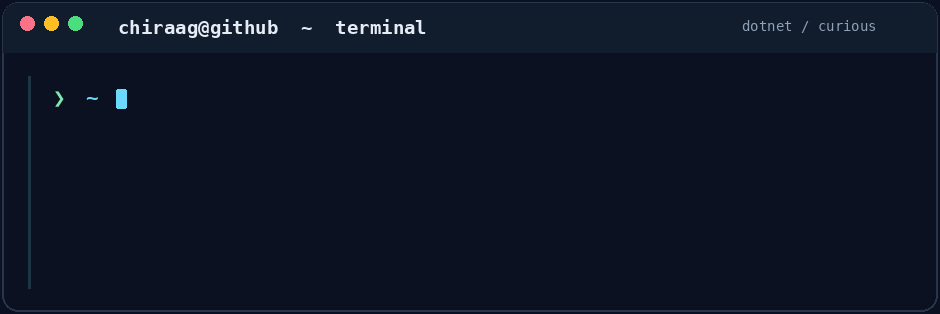

# Howdy, I'm Chiraag Bangera! 🤠

**Software engineer · Development team lead · C# / .NET**

## A bit about me

I'm a software engineer by profession and a builder by temperament. **C# and .NET are my home base.** I lead a development team, work on production software, and spend a fair amount of time investigating problems that don't have an obvious answer.

My work ranges from backend services and Azure infrastructure to desktop applications, 3D tooling, and computer vision. Outside of work, I tend to pick up projects involving robotics, embedded systems, or the occasional piece of software I'd rather take apart than treat as a black box.

## What I work with

| Area | Tools and interests |
| :--- | :--- |
| **Backend** | C#, .NET, ASP.NET Core, REST APIs, Entity Framework Core |
| **Cloud and delivery** | Azure, Azure DevOps, CI/CD, production diagnostics |
| **Data** | SQL Server, relational data, query performance |
| **Desktop and 3D** | .NET desktop applications, Unity, 3D graphics |
| **Beyond the day job** | Computer vision, robotics, embedded systems, reverse engineering |

### Toolbox

  
  
  
  
  
  
  
  
  
  

## GitHub activity

### My contribution graph has a visitor

<picture>
  <source media="(prefers-color-scheme: dark)" srcset="https://raw.githubusercontent.com/chiraagbangera/chiraagbangera/output/github-snake-dark.svg" />
  <source media="(prefers-color-scheme: light)" srcset="https://raw.githubusercontent.com/chiraagbangera/chiraagbangera/output/github-snake.svg" />
  
</picture>

<strong>When I'm not writing software</strong>

Photography, drones, travel, DIY electronics, gaming, and time with Zeus, my Labrador. He has a fairly convincing argument that he's the one running things.

---

  <a href="https://bangera.io">Website</a> ·
  <a href="https://www.linkedin.com/in/chiraagbangera/">LinkedIn</a> ·
  <a href="mailto:chiraag.bangera@live.com">Email</a>

